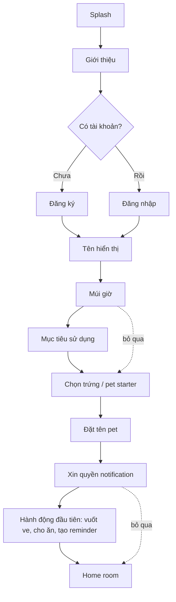
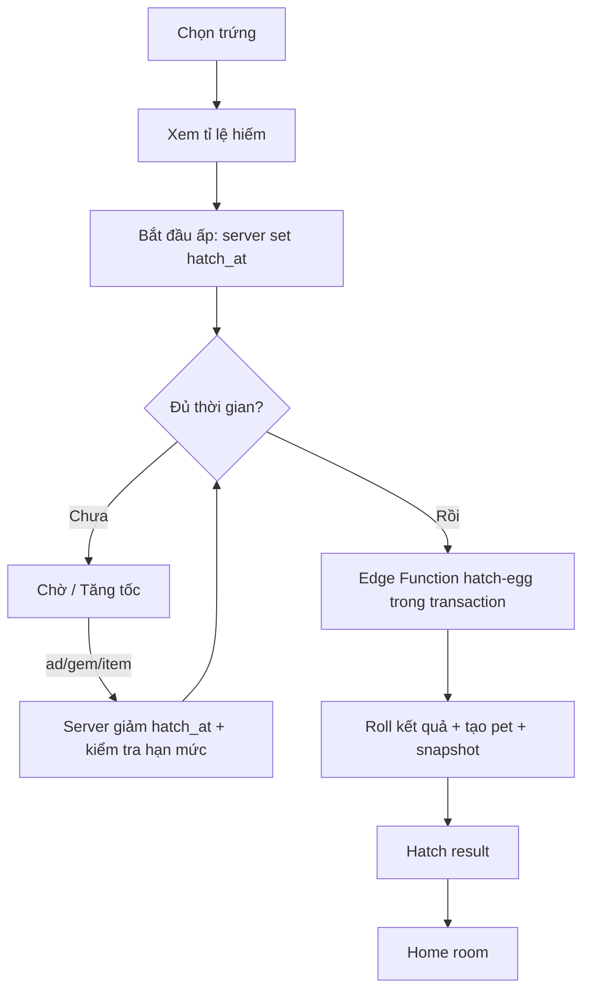
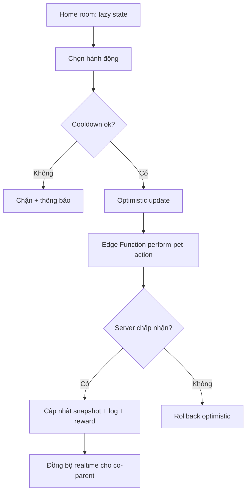
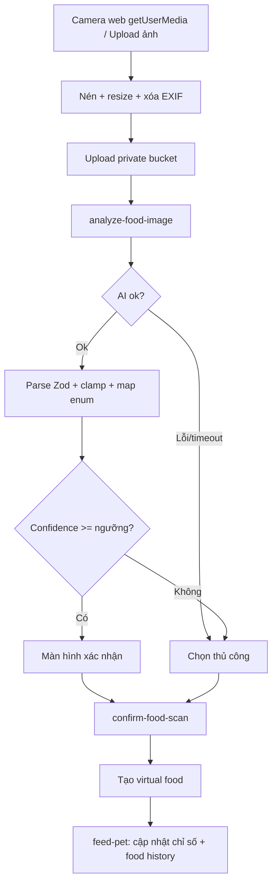
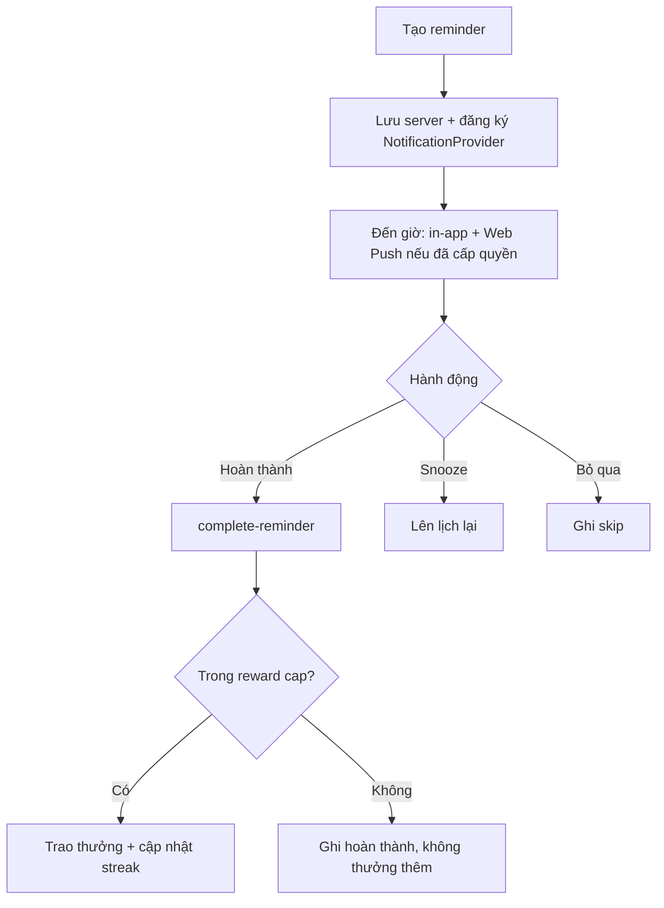
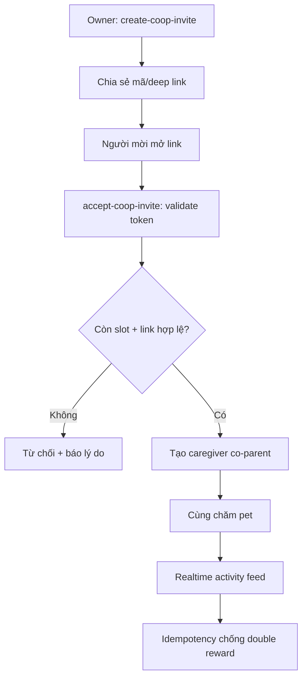
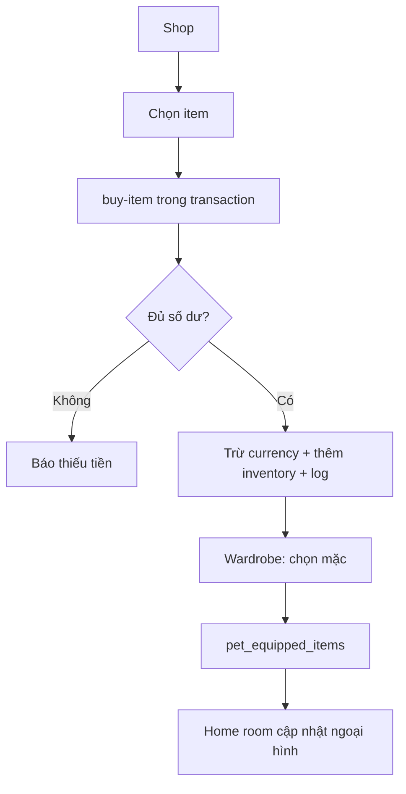

# 03 — User Flows

> Các luồng chính của MVP dưới dạng bước và sơ đồ Mermaid. Nhấn mạnh ranh giới client/server và điểm chống gian lận.
> **Nền tảng: WEB-FIRST.** Các luồng chạy trên web (Next.js/PWA): "camera" là `MediaDevices.getUserMedia` luôn kèm upload ảnh; "notification" là in-app + Web Push (service worker); "deep link" là link mời web. Browser API đi qua `adapters/`, business logic nằm ở `domain/` để mobile (Phase 10) tái sử dụng.

## 1. Onboarding

### Các bước
1. Splash → màn hình giới thiệu ngắn.
2. Đăng ký/đăng nhập (email; Google/Apple nếu bật).
3. Nhập tên hiển thị.
4. Chọn múi giờ (mặc định theo thiết bị, cho sửa).
5. Chọn mục tiêu sử dụng (đa lựa chọn).
6. Chọn trứng hoặc pet starter.
7. Đặt tên pet.
8. Xin quyền notification (có thể từ chối, nhắc lại sau).
9. Hướng dẫn hành động đầu tiên: vuốt ve → cho ăn → tạo reminder đầu tiên.
10. Vào Home room.

Bước 4, 5, 8, 9 có thể bỏ qua. Bước tài khoản, chọn pet, đặt tên là bắt buộc.

## 2. Ấp và nở trứng

### Các bước
1. Người dùng chọn trứng; app hiển thị **tỉ lệ hiếm minh bạch** (từ config backend).
2. Bắt đầu ấp → server ghi `started_at` và `hatch_at` (thời gian tính phía server).
3. Client hiển thị đếm ngược; realtime cập nhật cho co-op.
4. Tùy chọn tăng tốc: rewarded ad (mock, ≤10/ngày, đếm server) / gem / vật phẩm.
5. Khi đủ thời gian → gọi Edge Function `hatch-egg`.
6. Server trong **transaction**: roll kết quả (loài/màu/rarity/tính cách/chỉ số) theo `hatch_probability_configs`, tạo `pets` + snapshot, đánh dấu trứng đã dùng (idempotent).
7. Trả kết quả hatch → màn hình Hatch result → về Home room.

## 3. Chăm pet

### Các bước
1. Ở Home room, chỉ số hiển thị theo **lazy calculation** (snapshot cuối + thời gian trôi qua + loài + tính cách + trạng thái ngủ + buff/debuff).
2. Người dùng chọn hành động (cho ăn, vuốt ve, chơi, dọn phòng, tắm, cho ngủ, đánh thức…).
3. Client kiểm tra cooldown cục bộ và làm optimistic update.
4. Gọi Edge Function `perform-pet-action` (hoặc `feed-pet`).
5. Server validate quyền + cooldown + tài nguyên, cập nhật snapshot, ghi `pet_action_logs`, cộng XP/affection theo giới hạn.
6. Trả trạng thái mới → client hòa hợp; nếu server từ chối → rollback optimistic update.

## 4. AI nhận diện đồ ăn & fallback thủ công

### Các bước
1. Mở camera web (`MediaDevices.getUserMedia`, qua adapter) **hoặc** upload ảnh từ thiết bị (luôn có, dùng khi không cấp quyền camera hoặc trên desktop).
2. Client nén + resize + xóa EXIF nếu phù hợp.
3. Upload vào private bucket → nhận key.
4. Gọi Edge Function `analyze-food-image`: validate MIME/size → gọi AI Vision (qua abstraction layer).
5. Parse JSON theo schema Zod, clamp số, map category vào enum, gắn `visual_asset_key`.
6. Trả kết quả chuẩn hóa + danh sách `food_scan_candidates`.
7. **Nhánh confidence cao** → màn hình xác nhận (chấp nhận / đổi món / chọn nhóm).
8. **Nhánh confidence thấp (< ngưỡng)** → màn hình chọn thủ công (gợi ý / category / tìm kiếm / "không phải đồ ăn").
9. Người dùng xác nhận → `confirm-food-scan` tạo `virtual_food_items`.
10. `feed-pet` cập nhật chỉ số theo food category, ghi `pet_feeding_logs` + `food_scans`.
11. Nếu AI lỗi/timeout → đi thẳng nhánh thủ công, không chặn luồng.

## 5. Reminder

### Các bước
1. Tạo reminder (tiêu đề, nội dung, icon, thời gian, múi giờ, lặp, riêng/chung, phần thưởng, snooze).
2. Lưu `reminders` + `reminder_schedules` phía server; đăng ký lịch qua `NotificationProvider` (adapter). Lịch tính từ dữ liệu server, **không** phụ thuộc `setTimeout` trong tab.
3. Đến giờ → **in-app reminder** (luôn có) + **Web Push** qua service worker nếu đã cấp quyền; nội dung theo cá tính pet.
4. Người dùng: hoàn thành / bỏ qua / snooze / hoàn thành muộn.
5. Hoàn thành → `complete-reminder`: server kiểm tra reward cap ngày, trao thưởng, ghi `reminder_completions`, cập nhật `habit_streaks`.
6. Reminder chung (co-op) đồng bộ realtime cho cả hai.

## 6. Co-op hai người

### Các bước
1. Owner tạo lời mời (mã / link mời web / username) qua `create-coop-invite`.
2. Chia sẻ link/mã cho người thứ hai.
3. Người được mời mở link mời web → route xử lý → validate token qua `accept-coop-invite` (token dùng lại được cho deep link mobile sau).
4. Server kiểm tra: pet chưa đủ 2 caregiver, lời mời còn hạn/chưa dùng → tạo `pet_caregivers` role co-parent.
5. Cả hai vào cùng pet; mọi hành động phát realtime vào `coop_activity_logs`.
6. Hành động đồng thời dùng idempotency/optimistic lock để tránh double reward.
7. Co-op streak cập nhật khi ít nhất một người hoạt động trong ngày.

## 7. Mua và trang bị cosmetic

### Các bước
1. Mở Shop → xem item (giá coin/gem, rarity, tương thích loài).
2. Chọn mua → `buy-item` (qua perform/currency function): server kiểm tra số dư trong transaction.
3. Trừ coin/gem, thêm vào `inventory_items`, ghi `currency_transactions`.
4. Vào Wardrobe/Inventory → chọn mặc → ghi `pet_equipped_items`.
5. Home room cập nhật ngoại hình pet; phát `item_purchased`, `cosmetic_equipped`.

