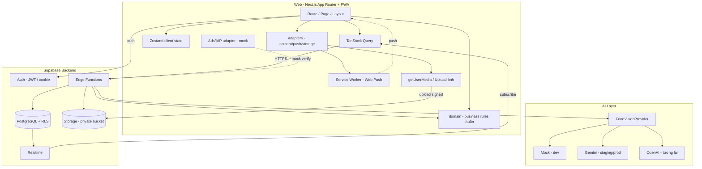

# 04 — System Architecture (Web-first)

> Kiến trúc tổng thể MochiPet cho MVP **web-first**: web client (Next.js), Supabase backend, AI layer, storage, realtime và notification. Nguyên tắc xuyên suốt: **client không đáng tin cậy**, mọi thay đổi giá trị (currency, rarity, reward, chỉ số) đi qua server. **Domain layer tách khỏi UI và browser API** để tái sử dụng cho mobile (Phase 10).

## 1. Tổng quan tầng

| Tầng | Thành phần | Trách nhiệm |
|------|-----------|-------------|
| Web client | Next.js (App Router), React, TypeScript, Tailwind + shadcn/ui, Zustand, TanStack Query, Framer Motion | UI, routing, client state, optimistic update, lazy hiển thị chỉ số, PWA |
| Domain (chia sẻ) | `src/domain/` TypeScript thuần | Business rules: pet-state, hatch, feeding, currency, reminder, co-op. **Không** phụ thuộc React/Next/browser. Dùng lại cho mobile |
| Adapters | `src/adapters/` | Bọc browser API: camera (`getUserMedia`), storage, push/service worker, clipboard… qua interface. Mobile cung cấp implementation riêng |
| API / Logic | Supabase Edge Functions (Deno/TS) | Business logic nhạy cảm: hatch, feed, action, reward, currency, co-op, AI orchestration |
| Data | PostgreSQL (Supabase) + RLS | Lưu trữ, ràng buộc, transaction, DB functions nguyên tử |
| Auth | Supabase Auth | Email/password (+ interface Google/Apple), JWT, session (cookie server-side cho Next.js) |
| Storage | Supabase Storage (private bucket) | Ảnh đồ ăn, ảnh community; truy cập qua signed URL có hạn |
| Realtime | Supabase Realtime | Đồng bộ trạng thái pet, activity feed co-op, reminder chung |
| AI | `FoodVisionProvider` abstraction | Vision nhận diện đồ ăn; gọi từ Edge Function, key phía server. Mock (dev) / Gemini (staging, prod) / OpenAI (tương lai) |
| Notification | `NotificationProvider` adapter → Web Push + service worker | In-app reminder (bắt buộc) + browser push sau khi cấp quyền |
| Monetization | Ads/IAP adapter (mock ở MVP) | Rewarded ad, IAP, subscription qua interface chung |

## 2. Phân định trách nhiệm client vs server

### Web client CHỈ được phép
- Render và routing (App Router); giữ client state (UI, form, cache).
- **Đọc** snapshot chỉ số rồi tính hiển thị lazy bằng hàm trong `domain/` (không ghi giá trị chuẩn).
- Optimistic update tạm thời, luôn có rollback khi server từ chối.
- Nén/resize ảnh, xin quyền, đăng ký lịch notification qua adapter.
- Kiểm tra cooldown ở mức UX (không phải nguồn sự thật).

### Server (Edge Function + DB) LÀ nguồn sự thật
- Tính `hatch_at`, roll rarity, tạo pet — trong transaction.
- Cập nhật chỉ số chuẩn, cộng/trừ coin/gem/XP, áp reward cap.
- Kiểm tra quyền (owner/co-parent), cooldown thật, idempotency.
- Đếm hạn mức rewarded ad, food scan, invite.
- Gọi AI, validate schema, chuẩn hóa taxonomy.
- Enforce RLS trên mọi bảng dữ liệu người dùng.

> Quy tắc vàng: **không để client tự cộng coin, gem, XP hay đổi rarity.**

### Ranh giới domain (bắt buộc để tái sử dụng cho mobile)
- Business logic nằm ở `domain/`, **không** trong page/component.
- `domain/` không import React/Next/`window`/`document`/`navigator`/service worker.
- Truy cập browser API chỉ qua `adapters/`; Edge Function dùng lại cùng domain rules (chia sẻ qua package/types).

## 3. Luồng dữ liệu chính

### 3.1 Hành động chăm pet / kiếm thưởng
```
Web client (optimistic) → Edge Function → validate + DB transaction → cập nhật snapshot/currency
→ trả state chuẩn → client reconcile → Realtime broadcast cho co-parent
```

### 3.2 AI food scan
```
Client: camera getUserMedia HOẶC upload → nén ảnh → upload private bucket
→ Edge Function analyze-food-image → FoodVisionProvider (mock/gemini, key server-side)
→ parse Zod + clamp + map enum → trả kết quả chuẩn hóa
→ client xác nhận/fallback thủ công → confirm-food-scan + feed-pet (transaction)
```

### 3.3 Co-op realtime
```
Caregiver A hành động → Edge Function ghi log + cập nhật state
→ Postgres change → Supabase Realtime → Caregiver B nhận cập nhật live
```

### 3.4 Reminder & notification (web)
```
Client tạo reminder → lưu DB (server là lịch chuẩn)
→ NotificationProvider đăng ký; service worker + Web Push kích hoạt đúng giờ (không dựa timer trong tab)
→ in-app reminder luôn hiển thị → hoàn thành → complete-reminder (server áp reward cap + streak)
```

## 4. AI Provider abstraction

- Interface chung `FoodVisionProvider` (input: ảnh/URL; output: JSON theo schema).
- Adapter: **MockVisionProvider** (development), **Gemini Vision** (staging/production), OpenAI (thêm sau, không sửa business logic).
- Chọn provider qua env `AI_PROVIDER`; khi chưa có key → mock chạy toàn luồng.
- Mọi kết quả AI luôn qua lớp validate (Zod) + normalize trước khi ghi.

## 5. Notification abstraction (web → mobile)

- `NotificationProvider` interface tách khỏi domain.
- Web implementation: in-app toast/center + Web Push qua service worker (bật sau khi `Notification.requestPermission`).
- Mobile implementation (Phase 10): Expo Notifications, thay adapter mà không đụng domain reminder logic.
- Lịch nhắc tính từ dữ liệu server; khôi phục khi mở app; không phụ thuộc tab đang mở.

## 6. Bảo mật ở mức kiến trúc

- RLS bật cho toàn bộ bảng dữ liệu người dùng; policy theo `auth.uid()` và quan hệ caregiver.
- Private storage + signed URL ngắn hạn cho ảnh; không public bucket ảnh đồ ăn.
- AI key, service_role key chỉ ở Edge Function/secret, **không** trong client bundle.
- Với Next.js: dùng Supabase server client + middleware cho session; publishable key + RLS phía browser.
- Idempotency key cho mọi giao dịch thưởng/currency; chống replay.
- Rate limit: food scan, AI chat, invite.
- Sanitize text người dùng; validate MIME/size; xóa EXIF.
- Audit log cho giao dịch quan trọng.

## 7. Sơ đồ kiến trúc



## 8. Môi trường & triển khai

- **Local dev**: Next.js dev server + Supabase project (dev) + MockVisionProvider.
- **Staging/Prod**: host web (vd Vercel/Node host) + Supabase project theo env + Gemini Vision. Edge Functions deploy qua Supabase CLI; secret quản lý ở Supabase, không commit.
- Cấu hình runtime: biến `NEXT_PUBLIC_*` (client, public) trong `.env`; secret server (service role, AI key) ở Supabase secrets. Chi tiết ở `07-technical-plan.md`.
- **Phase 10 (mobile)**: thêm Expo app dùng lại Supabase + `domain/`; chỉ khác UI và adapters (camera, push, storage).
