# 05 — Database ERD (Conceptual)

> Phase 1 chỉ mô tả **khái niệm entity + quan hệ + ERD**. Chưa viết SQL migration (để Phase 3). Danh sách bảng bám theo mục 19 của `CLAUDE.md`.
>
> **Không thay đổi theo pivot web-first.** Database schema và backend Supabase được **giữ nguyên và dùng chung** cho web (MVP) và mobile (Phase 10). Migration đặt tại `supabase/migrations/`, seed tại `supabase/seed.sql`.

## 1. Nhóm entity chính

### 1.1 Người dùng & cấu hình
- **profiles** — hồ sơ người dùng (map 1-1 với auth user).
- **user_settings** — cài đặt, mục tiêu sử dụng, quyền notification, riêng tư.
- **app_config** — cấu hình toàn cục (ngưỡng confidence, reward cap, tốc độ giảm chỉ số…).
- **feature_flags** — bật/tắt tính năng theo môi trường/người dùng.

### 1.2 Định nghĩa pet (dữ liệu tĩnh / catalog)
- **pet_species** — loài (tốc độ giảm đói/năng lượng, sở thích đồ ăn, tỉ lệ hiếm…).
- **pet_personalities** — tính cách và ảnh hưởng.
- **pet_color_variants** — biến thể màu theo loài.
- **egg_types** — loại trứng.
- **hatch_probability_configs** — cấu hình tỉ lệ rarity theo loại trứng.

### 1.3 Pet & vòng đời
- **eggs** — trứng cụ thể của người dùng (trạng thái ấp, hatch_at).
- **pets** — pet đã nở (loài, màu, rarity, tính cách, chủ sở hữu).
- **pet_caregivers** — quan hệ nhiều-nhiều người ↔ pet với role (owner/co-parent).
- **pet_state_snapshots** — snapshot chỉ số + timestamp cho lazy calculation.
- **pet_action_logs** — log hành động chăm pet.
- **pet_dialogue_logs** — log câu thoại (template engine).

### 1.4 Đồ ăn & food scan
- **food_categories** — nhóm đồ ăn (rice, noodles, dessert…) + hiệu ứng gameplay.
- **food_catalog** — món ăn mẫu/chuẩn hóa.
- **food_scans** — mỗi lần chụp/nhận diện.
- **food_scan_candidates** — các ứng viên món cho một lần scan.
- **virtual_food_items** — thức ăn ảo tạo ra để feed.
- **pet_feeding_logs** — log feed pet.

### 1.5 Vật phẩm, phòng, cosmetic
- **item_catalog** — danh mục item (rarity, giá coin/gem, tương thích loài).
- **inventory_items** — item người dùng sở hữu.
- **pet_equipped_items** — item đang mặc trên pet.
- **rooms** — phòng của pet.
- **room_equipped_items** — item trang trí trong phòng.

### 1.6 Reminder & habit
- **reminders** — nhắc việc.
- **reminder_schedules** — lịch lặp.
- **reminder_completions** — lần hoàn thành/skip/snooze.
- **habit_streaks** — streak thói quen (cá nhân & co-op).

### 1.7 Quest, currency, monetization
- **quests** — định nghĩa nhiệm vụ (config backend).
- **quest_progress** — tiến độ theo người dùng.
- **currencies** — loại tiền (coin, gem).
- **currency_transactions** — sổ giao dịch tiền (audit).
- **ad_reward_logs** — log rewarded ad (đếm hạn mức).
- **purchases** — giao dịch mua (mock ở MVP).
- **subscriptions** — gói đăng ký (mock ở MVP).

### 1.8 Co-op & mini game
- **coop_invites** — lời mời co-op (token, hạn dùng).
- **coop_activity_logs** — hoạt động co-op cho realtime feed.
- **mini_game_sessions** — phiên chơi.
- **mini_game_rewards** — thưởng mini game (server verify).

### 1.9 Notification & community
- **notifications** — thông báo trong app.
- **user_follows** — theo dõi người dùng.
- **community_posts** — bài đăng cộng đồng.
- **community_likes** — like.
- **reports** — báo cáo nội dung.

## 2. Quan hệ chính (tóm tắt)

- `profiles (1) — (1) user_settings`
- `profiles (1) — (n) pet_caregivers (n) — (1) pets` → người ↔ pet là **nhiều-nhiều** qua `pet_caregivers` (tối đa 2 caregiver/pet ở MVP).
- `pet_species (1) — (n) pets`, `pet_personalities (1) — (n) pets`, `pet_color_variants (1) — (n) pets`.
- `egg_types (1) — (n) eggs`, `hatch_probability_configs (n) — (1) egg_types`.
- `eggs (1) — (0..1) pets` (một trứng nở ra một pet).
- `pets (1) — (n) pet_state_snapshots / pet_action_logs / pet_dialogue_logs`.
- `pets (1) — (1) rooms (1) — (n) room_equipped_items`.
- `food_categories (1) — (n) food_catalog / virtual_food_items`.
- `food_scans (1) — (n) food_scan_candidates`; `food_scans (1) — (0..1) virtual_food_items`.
- `pets (1) — (n) pet_feeding_logs (n) — (1) virtual_food_items`.
- `item_catalog (1) — (n) inventory_items`; `inventory_items (1) — (0..1) pet_equipped_items`.
- `profiles (1) — (n) reminders (1) — (n) reminder_schedules / reminder_completions`.
- `reminders (1) — (0..1) habit_streaks` (streak theo thói quen/pet).
- `quests (1) — (n) quest_progress (n) — (1) profiles`.
- `profiles (1) — (n) currency_transactions`; `currencies (1) — (n) currency_transactions`.
- `pets (1) — (n) coop_invites`; `coop_invites (1) — (0..1) pet_caregivers` (khi chấp nhận).
- `profiles (1) — (n) mini_game_sessions (1) — (n) mini_game_rewards`.

## 3. Mermaid ERD

> ERD khái niệm — thể hiện entity và quan hệ chính, không liệt kê toàn bộ cột (chi tiết cột ở Phase 3).

```mermaid
erDiagram
    profiles ||--|| user_settings : has
    profiles ||--o{ pet_caregivers : cares
    pets ||--o{ pet_caregivers : "cared by"
    pet_species ||--o{ pets : defines
    pet_personalities ||--o{ pets : traits
    pet_color_variants ||--o{ pets : color

    egg_types ||--o{ eggs : type
    egg_types ||--o{ hatch_probability_configs : rates
    eggs ||--o| pets : hatches

    pets ||--o{ pet_state_snapshots : snapshot
    pets ||--o{ pet_action_logs : actions
    pets ||--o{ pet_dialogue_logs : dialogue
    pets ||--|| rooms : lives_in
    rooms ||--o{ room_equipped_items : decorated

    food_categories ||--o{ food_catalog : groups
    food_categories ||--o{ virtual_food_items : maps
    food_scans ||--o{ food_scan_candidates : suggests
    food_scans ||--o| virtual_food_items : produces
    pets ||--o{ pet_feeding_logs : fed
    virtual_food_items ||--o{ pet_feeding_logs : used_in

    item_catalog ||--o{ inventory_items : instance
    profiles ||--o{ inventory_items : owns
    inventory_items ||--o| pet_equipped_items : equipped
    pets ||--o{ pet_equipped_items : wears

    profiles ||--o{ reminders : creates
    reminders ||--o{ reminder_schedules : repeats
    reminders ||--o{ reminder_completions : completed
    reminders ||--o| habit_streaks : streak

    quests ||--o{ quest_progress : tracked
    profiles ||--o{ quest_progress : progresses

    currencies ||--o{ currency_transactions : ledger
    profiles ||--o{ currency_transactions : balance
    profiles ||--o{ ad_reward_logs : watches
    profiles ||--o{ purchases : buys
    profiles ||--o{ subscriptions : subscribes

    pets ||--o{ coop_invites : invite_for
    coop_invites ||--o| pet_caregivers : grants
    pets ||--o{ coop_activity_logs : activity

    profiles ||--o{ mini_game_sessions : plays
    mini_game_sessions ||--o{ mini_game_rewards : rewards

    profiles ||--o{ notifications : receives
    profiles ||--o{ user_follows : follows
    profiles ||--o{ community_posts : posts
    community_posts ||--o{ community_likes : liked
    profiles ||--o{ reports : files

    app_config ||--o{ feature_flags : toggles
```

## 4. Ghi chú thiết kế cho Phase 3

- Mọi bảng dữ liệu người dùng: PK, FK, index cần thiết, `created_at`, `updated_at` (trigger), constraint, enum/check, RLS, soft delete nếu cần.
- Chỉ số pet lưu ở `pet_state_snapshots` + timestamp; **không** cột "hiện tại" tự cập nhật — tính lazy.
- `currency_transactions` là nguồn sự thật số dư (append-only, có audit); số dư tổng hợp có thể materialize sau.
- `coop_invites` cần token duy nhất, hạn dùng, trạng thái đã dùng để chống replay.
- Idempotency key cho các bảng ghi thưởng (feeding, action, quest, ad, mini game).
